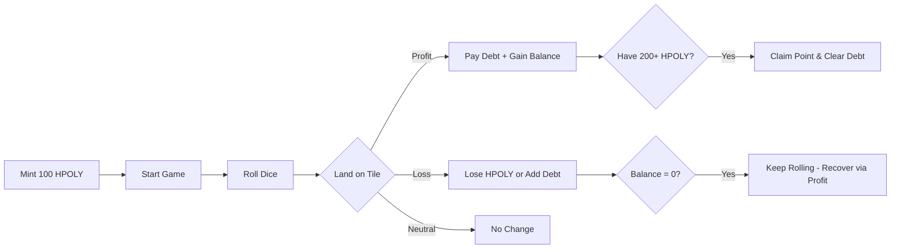

# 🏦 BOTPoly

> 🎯 **BOTPoly** is a decentralized, tokenized twist on *Monopoly* — blending gaming, NFTs, and DeFi strategy on **BOT Chain**. It demonstrates real-world use of smart contracts, on-chain randomness, and a dual-token economy (USDT & HPOLY) inside a fun, interactive experience.

## 🚨 Problem

Blockchain gaming today often faces three major problems:

* ❌ **Harsh Penalties & Lockouts**: Players get permanently locked out of games after a bad streak, ruining retention.
* 💸 **Poor Token Economy Design**: Single-token economies lack depth, leading to inflation or imbalance.
* 🕹️ **Limited True Ownership**: In-game assets are often trapped in closed ecosystems without cross-chain utility.

## 💡 Solution

BOTPoly solves these challenges through:

* ✅ **Playable, Balanced Economy**: A unique debt system that keeps players in the game. If you go bankrupt, you aren't locked out—you carry a capped debt that future profits automatically pay off.
* 🔥 **Deflationary HPOLY Tokenomics**: Players burn HPOLY to claim permanent points, creating a true sink.
* 💵 **USDT Boost Shop**: Integrates Test USDT for strategic advantages, adding a secondary economic layer.
* ⚡ **Fast, Low-Cost Transactions**: Powered by the **BOT Chain Testnet (Bohr)**, ensuring ultra-low latency and high throughput.

## 🕹️ Gameplay Overview

Players mint **100 HPOLY tokens (ERC-1155)** and begin their journey. They navigate a **12-tile game board**, rolling a virtual die to land on tiles that yield profit or loss:

| Tile Type | Token Change      | Example Range |
| --------- | ----------------- | ------------- |
| Profit    | +80 to +160 HPOLY | 🟩 Gain       |
| Loss      | −37 to −90 HPOLY* | 🟥 Lose       |
| Neutral   | 0                 | ⚪ Hold steady |

*(Note: Losses are softened by a 75% multiplier to ensure intermediate difficulty).*

### 🆕 The Debt & Recovery System
Unlike traditional games that end when you hit zero, BOTPoly features a dynamic **Debt System**:
* If a loss exceeds your balance, the remaining amount becomes **Debt** (capped at 300 HPOLY).
* You stay in the game with 0 HPOLY.
* When you land on a **Profit** tile, your earnings automatically pay off your debt first.
* **Claiming a Point** wipes your debt clean as a milestone reward.

### ⚡ USDT Boost Shop
Players can use **Test USDT** (ERC-20) to purchase strategic advantages:
* **Lucky Reroll (1 USDT)**: Reroll the dice after a bad landing.
* **Double Reward (2 USDT)**: Double the next Profit landing.

## 🧩 Features

* **ERC-1155 Tokens** – HPOLY tokens as the primary in-game currency.
* **ERC-20 Integration** – Seamless USDT payments for boost mechanics.
* **On-chain Pseudo-Randomness** – Utilizes block hashes and timestamps for dice rolls.
* **Debt Mechanics** – A capped debt system that prevents game-breaking lockouts.
* **Owner Controls** – Manage token caps, treasury address, and game parameters.

## 🧱 Architecture & Tech Stack

| Layer                 | Technology                   |
| --------------------- | ---------------------------- |
| **Smart Contract**    | Solidity (ERC-1155 & ERC-20) |
| **Blockchain**        | BOT Chain Testnet (Bohr)     |
| **Frontend**          | Vanilla JS + Web3.js         |
| **Wallets Supported** | MetaMask                     |
| **Randomness**        | Block.prevrandao + keccak256 |

## 🚀 Getting Started

### 1️⃣ Prerequisites
* Get **Test BOT** (for gas) and **Test USDT** via the BOT Chain [Faucet](https://faucet.botchain.ai/en/basic).
* Install [MetaMask Wallet](https://metamask.io/).
* Add the **BOT Chain Testnet (Bohr)** to your wallet:
  * **Network Name:** BOT Chain Testnet (Bohr)
  * **RPC URL:** `https://rpc.bohr.life`
  * **Chain ID:** `968`
  * **Symbol:** `tBOT`
  * **Explorer:** `https://scan.bohr.life`

### 2️⃣ Deploy & Play
1. Deploy the `BOTPoly.sol` contract on BOT Chain Testnet.
2. Mint 100 HPOLY tokens with `mintTokens()`.
3. Start the game with `startGame()`.
4. Roll dice with `rollDice(bool useDoubleReward)`.
5. Approve USDT and buy boosts with `buyReroll()` or `buyDoubleReward()`.
6. Burn required HPOLY to claim a point using `claimPoint()`.

## 🧾 Contract Details

* **Network:** BOT Chain Testnet
* **Game Contract Address:** `0xA44Af1aE5db00AB97F86717a1A3F92a55E770513`
* **USDT Contract Address:** `0x75edC9335175Fc0552D51D48439F229c10420fe3`

## 🎮 Game Preview

## 🧠 Gameplay Flow

## 🌍 Vision & Future Plans

🔗 Integrate Chainlink VRF for cryptographically secure verifiable randomness.
🏪 Add an NFT Marketplace for trading in-game artifacts.
🎮 Expand to multiplayer gameplay with leaderboards.
🌐 Deploy to BOT Chain Mainnet.
💰 Introduce staking & rewards for HPOLY holders.
